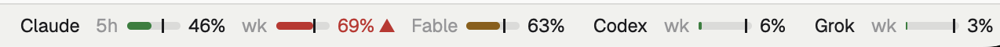

# token-status

Live plan-usage bars for **Claude Code**, **Codex** and **Grok Build** in a terminal pane.

```
Claude
  5-hour session  ↻ 2h 6m (Wed 17:20)
  ████████████░░░░░│░░░░░░░░░░░░  41.0%
  on pace for ~71% by reset
  Weekly (all models)  ↻ 2d 4h (Fri 20:00)
  ████████████████████│░░░░░░░░░  69.0%
  ▲ at this pace, limit in 2d 3h (Fri 19:00)
Codex
  Weekly  ↻ 23h 28m (Thu 14:42)
  ██░░░░░░░░░░░░░░░░░░░░░░░│░░░░   6.0%
  on pace for ~7% by reset
```

One Python 3 file, standard library only.

## Use

```sh
token-status            # all three, stacked
token-status claude     # or codex / grok
token-status all 120    # refresh every 120 s (default: 300 for all/claude, 120 for codex/grok)
```

The `│` on each bar marks how much of that limit's window has passed: usage to
its left is under budget. Below each bar is the projected use at reset, or, if
you're on track to run out, when the limit will be hit at the current rate:
amber while that is still far off, red with ▲ once it is within 24 hours (or
20% of the window, for short windows).

For scripts and agents, `--json` prints once and exits:

```sh
token-status --json            # all providers
token-status --json claude | jq '.claude.limits[] | {label, percent, pace}'
```

Each limit has `label`, `percent`, `resets_at`, `window_seconds` and
`pace` (`elapsed_pct`, `projected_pct`, `hits_limit_at`, `urgent`); each provider has
`note` and `error`.

The script restarts itself when its file changes, so edits show up in running panes.

## Install

```sh
git clone https://github.com/shanev/token-status
ln -s "$PWD/token-status/token-status" ~/.local/bin/token-status
```

## Agent skill

The optional [token-status skill](skills/token-status/SKILL.md) lets compatible
agents answer questions such as "How much Codex usage do I have left?" and
"Will I run out before reset?" using the CLI's live JSON output.

Install Python 3 and the CLI as described above, and sign in to the providers
you want to check using their own tools. Then install the skill:

```sh
npx skills add shanev/token-status --skill token-status
```

This command requires Node.js/npm and installs the agent instructions; the
CLI itself remains Python-only. From a local checkout, use
`npx skills add . --skill token-status`. Ask your agent to check plan usage;
the skill reports remaining percentages, reset times, pace estimates, and
provider errors. It does not report API billing or exact token counts.

The repository uses the standard `skills/<name>/SKILL.md` layout discovered
by the skills CLI. According to the [skills.sh FAQ](https://skills.sh/docs/faq),
directory listings are driven by installation telemetry, so no separate
submission is required after the skill is published on GitHub.

## Where the numbers come from

Each provider is read with that tool's own login on this machine, from the
same place the tool's own usage screen reads. No tokens are stored or sent
anywhere other than the provider's own server.

| Provider | Login read from | Asks |
|---|---|---|
| Claude | `~/.claude/.credentials.json` | `api.anthropic.com/api/oauth/usage` (Claude Code's `/usage`) |
| Codex | the installed `codex` CLI | `codex app-server` → `account/rateLimits/read` (Codex's `/status`) |
| Grok | `~/.grok/auth.json` | `cli-chat-proxy.grok.com/v1/billing` (Grok's `/usage`); an expired token is renewed with `grok models`, which makes no model call |

None of these are documented public APIs, so they can change without notice.

Codex discovery uses `PATH` first, then common per-user, npm, system, and
Homebrew install directories on macOS and Linux. This also works when a GUI
app starts token-status with a minimal `PATH`. For other install locations
(including version-manager installs), set `CODEX_BIN` to the full executable
path in the environment that launches token-status. `CODEX_BIN` takes
precedence over automatic discovery.

## Herdr

To bring it up beside the focused pane in [Herdr](https://herdr.dev) 2, bind a key in
`~/.config/herdr-app/keys.json`:

```json
"cmd-shift-u": {"command": "pane.split", "args": {"direction": "right",
  "argv": ["/bin/sh", "-c", "exec \"$HOME/.local/bin/token-status\""]}}
```

Herdr starts the program without your shell's PATH, so the binding uses the
install path. It runs on the machine of the focused pane, so install
token-status there.

### Herdr usage strip (mod)



`herdr/usage-strip/` is a Herdr 2 mod: a mini bar per limit
(`Claude 5h ▬│ 45% · wk ▬│ 69% ▲ · Fable ▬│ 63% · Codex wk 6% · Grok wk 3%`),
colored by pace, with the │ tick at the time elapsed in each window. A limit on
track to run out before it resets turns amber, and red with ▲ once the run-out
is within 24 hours (or 20% of a shorter window). Hover a limit for its reset and projection;
click the strip for a details popup (Esc closes it) with Refresh and Open panel.
It runs `token-status --json` every 5 minutes.

```sh
cp -r herdr/usage-strip ~/.config/herdr-app/mods/
herdr-app check ~/.config/herdr-app/mods/usage-strip
```

Set `MACHINE` at the top of `main.js` to the machine name (from `hc machine ls`)
where token-status is installed, or leave it `null` for the machine running Herdr.

Herdr's own layouts are read-only, so show the strip from a layout of your own:
`herdr-app do layout.clone '{"name":"main","as":"main-usage"}'`, then in
`~/.config/herdr-app/layouts/main-usage.json` replace the work column's
`status` block with a row holding it and the strip:

```json
{ "type": "row", "id": "statusbar", "size": { "px": 28 }, "children": [
  { "type": "block", "id": "status", "size": { "weight": 1 }, "content": { "mod": "workspace-status" } },
  { "type": "block", "id": "usage", "size": { "weight": 2 }, "content": { "mod": "usage-strip" } } ] }
```

The strip right-aligns itself. To drop the status bar's command-palette hint,
`herdr-app do mod.clone '{"name":"workspace-status","as":"workspace-status-lite"}'`,
delete the last two `.child(...)` lines of its `render()` (the spacer and the
hint), and point the `status` block at `workspace-status-lite`.
